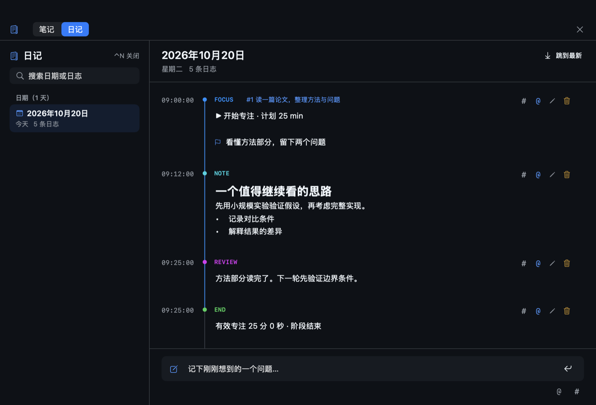

# Timeline

Color your thread.

Timeline 是 macOS 原生任务管理应用，包含待办时间线、月历、快速记录、专注计时、笔记和日记。无需账号，数据存储在本机。


## 待办时间线

任务沿连续轴线排列，截止日期和时间位于轴线左侧。连续的已完成、已放弃任务默认折叠，可在原位置展开。已完成任务显示删除线与勾选，已放弃任务显示叉号和状态标识。

悬停重要性圆点可设置优先级，按住圆点可拖动排序，拖到月历日期可修改截止日期。任务行和月历条目的最右侧均为完成按钮。

## 快捷键

| 默认快捷键 | 界面 |
| --- | --- |
| `⌃⌥D` | 主界面：待办时间线与月历 |
| `⌃⌥L` | 快速记录：日志与待办输入 |
| `⌃⌥F` | 专注工作台：任务选择、目标与倒计时 |
| `⌃N` | 笔记 / 日记：按标签整理，或按日期回看 |
| `⌃⌥T` | 内置终端 |

`⌃` 是 Control，`⌥` 是 Option。快捷键可以在设置里修改。

## 快速记录

独立输入面板，支持文字、图片和待办。


`Enter` 换行，`⌘Enter` 保存。`@` 关联任务，`#` 添加标签。

## 专注计时

选择任务并填写本轮目标后启动倒计时。计时期间可记录笔记，切换窗口不影响计时。结束后可填写阶段反馈。


## 笔记与日记

Notes 按标签组织笔记，Journal 按日期显示日志。专注记录包含目标、时间戳和阶段反馈。



截图均使用示例数据。

## 安装

需要 macOS 13 或更高版本，以及 Xcode 或 Swift 命令行工具。在仓库目录运行：

```sh
bash scripts/install.sh
```

应用安装到 `~/Applications/Timeline.app`，更新前请先退出。

数据保存在 `~/Library/Application Support/Timeline/`，支持自动备份、导出和恢复。旧版迁移说明见 [MIGRATION.md](MIGRATION.md)。

[MIT License](LICENSE)
