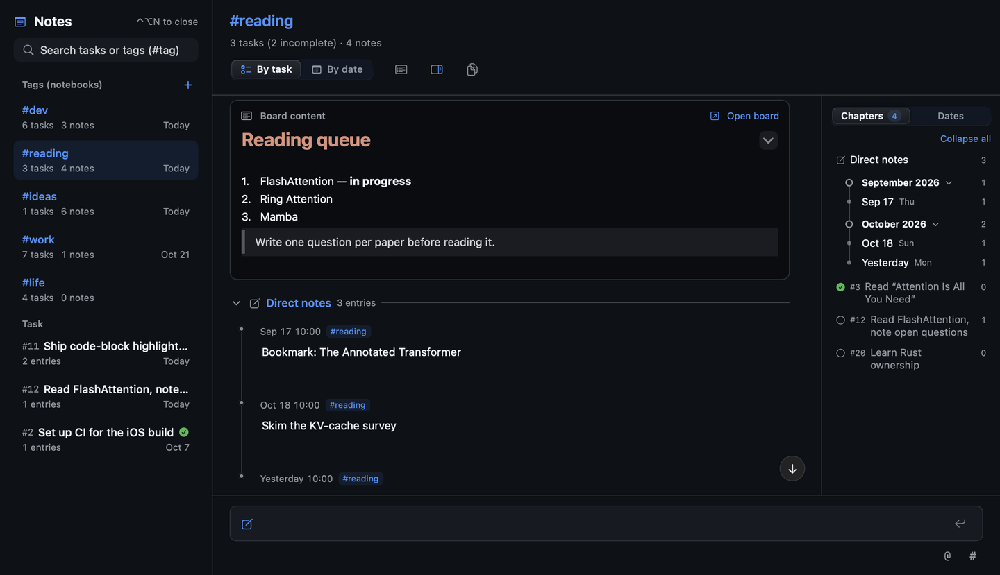
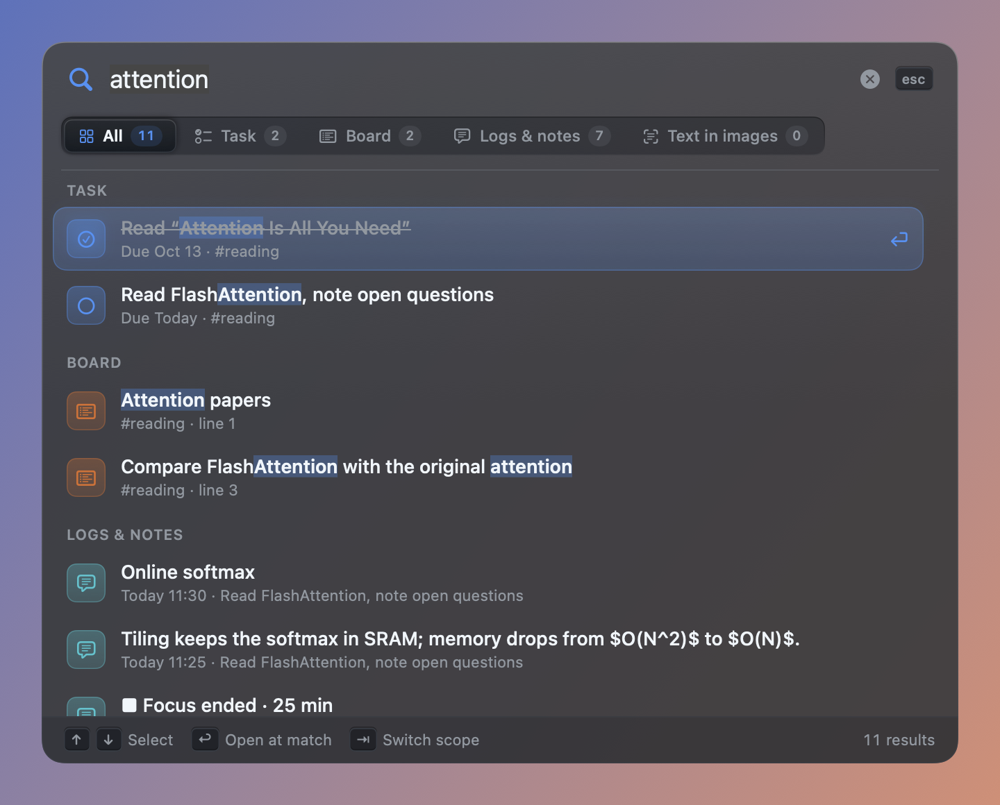
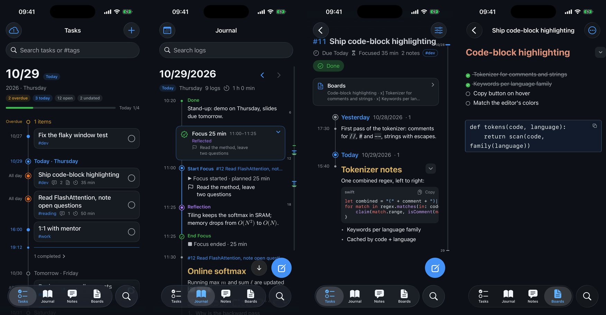

# Timeline

## 手写的介绍

*(Last updated 2026-10-30)*

Obsidian 的移动端很难用。各种笔记软件显示的具体时间戳都不够直观，我感觉它们没有时间的味道。我又很想自己尝试开发一个软件，看看现在的agent能做到什么程度。它们很强，这个就是它们的作品，我只是在许愿。

我消费了很多时间和token，用AI来vibe coding这个app的界面、功能，交互的各种细节。开发过程中，我随意使用一段时间就能发现一些bug和我觉得应该实现，但AI没有实现的地方。不过我逐渐没活了。

主要特点大概是你可以记录一些日志，它们在界面上以时间轴呈现出来；你也可以给日志打标签，打了标签的日志可以按标签筛选出来，也就是笔记界面，一个标签就是一个笔记本。任务也可以有标签。

主要的界面。有以下这些，
Ctrl + Option + (D/N/F/L/M/Tab) 可以唤起它们：
- **[D for Dashboard]** 设置和安排任务的日历和主界面，
- **[N for Notes]** 以标签和标签下的任务组织成的笔记，日记，
- **[F for Focus]** 专注计时工作台（让我在阅读时感受到时间的流动），
- **[L for Log]** 快速日志/任务输入界面（方便随时按出来写点东西），
- **[M for Memo]** 一个附在所有标签/任务下的board，用来记录一些很快会被删掉的内容，或者随时需要复制粘贴的内容，
- **[Tab for Terminal]** 是一个模仿ghostty功能的可以随时唤起的终端。

我把大写锁定键(标着中/英的那个键) 改成 Ctrl (macOS设置里就可以改)。

另外一个细节是除了 Focus Panel 是按 Enter 来提交内容，大部分的输入框都是按 **Command + Enter** 来提交内容，因为我的 Wechat 是这么设置的，这样我可以在 Wechat 里按 Enter 而不是 Option + Enter 来换行。

存储文本内容的似乎是一个 journal.sqlite 文件，iOS 和 macOS 端使用免费用户的 5GB iCloud Drive 进行缓慢的同步。每个月给apple交一点钱就可以记一辈子。

看下面的 Build & Run 部分，或者让 agent 帮你安装。

后面就是AI生成的内容。

## AI generated README

*(last updated 2026-10-30)*

A native macOS + iPhone app for tasks, focus sessions, notes and a daily journal. The Mac app lives in the background and opens panels from global hotkeys or the menu bar. No account and no server: data lives in a local SQLite database, and devices sync through a folder in iCloud Drive.


## News

- **2026-10-30**
  - Local data moved to incremental SQLite storage; saves now write only what changed.
  - iPhone: full backup and restore with original images, faster background search, and a quiet sync icon that stays out of the way while typing.
  - Sync: a damaged device no longer blocks the others and can be retired; the status now separates local save, upload and delivery.
  - Headings inside blockquotes can be folded on both platforms.

## Features

### Mac

| | |
| --- | --- |
| **Timeline + calendar** (`⌃⌥D`) | Tasks, with optional time ranges, on a vertical timeline with a "now" marker; a month calendar shows per-day progress and focus time. Drag a task's dot to reorder it, or drop it on another date to reschedule it. Single-key actions on the selected task (`Space` done, `D` date, `M`/`⇧M` shift a day, `F` focus, `?` help). |
| **Quick capture** (`⌃⌥L`) | Add a task or a journal entry from any app. `@` links a task, `#` adds a tag, `⌘V` pastes images; text in images is recognized (Vision) and searchable. |
| **Focus** (`⌃⌥F`) | Pick a task, set a goal and length. While running, the panel shrinks to a translucent companion docked to the screen edge, styled as a card, capsule, digits or a dot, or moves to the menu bar; the session ends with a reflection written to the journal. |
| **Notes & journal** (`⌃⌥N`) | One notebook per task and per tag (grouped by task or by date), plus a day-by-day journal with a rhythm bar and a summary card at the end of each day. Entries are Markdown with LaTeX math, highlighted code blocks with a copy button, tables, and foldable headings and `<details>` blocks. Click an entry to select it and click again to edit it in place, WYSIWYG; edits save as you type. |
| **Boards** (`⌃⌥M`) | A Markdown page per task or tag, with live-rendered checklists, folds, code and tables, a favorites bar, and version history. |
| **Terminal** (`⌃⌥Tab`) | Built-in terminal with tabs and splits. |
| **Search** (`⌃⌥S`) | One panel across tasks, boards, logs and text in images. |
| **Safety net** | Deleted logs, tasks and boards stay in Recently Deleted for 30 days; backup and restore cover the journal and its images. |

<p>


</p>
<p>


</p>
<p>


</p>

### iPhone

Tasks, journal, notebooks, boards and search over the same data. It adds task reminders, a focus timer with a Live Activity, a quick-capture widget, Spotlight indexing, and a composer with `@`/`#` pickers, image paste and the camera. Recently Deleted and full backup and restore with original images are built in. Markdown, math and code render natively, and logs and boards are edited with the same editor as on the Mac.



## Architecture

```
Sources/
  TimelineCore/    Data layer shared by Mac and iPhone (no UI): journal model, SQLite storage, tasks,
                   boards, tags, quick-add parsing, Markdown/math scanning, code highlighting, folder sync
  CSQLite/         Module map for the system sqlite3 library
  TimelineMath/    LaTeX typesetting on CoreText (vendored SwiftMath + Latin Modern fonts)
  Timeline/        macOS app: AppKit windows/panels hosting SwiftUI views
    EditorAssets/  Bundled CodeMirror editor (built from Editor/)
Editor/            CodeMirror 6 + KaTeX source, bundled with esbuild into one editor.js
iOS/               SwiftUI iPhone app (Xcode project) using TimelineCore, TimelineMath, EditorAssets;
                   TimelineFocus holds the Live Activity and quick-capture widget
Tests/             TimelineCoreTests (model) and TimelineUITests (views, rendered offscreen)
scripts/           build / install / screenshot / test helpers
```

- **Storage.** `JournalStore` (TimelineCore) keeps its data in `journal.sqlite` under `~/Library/Application Support/Timeline`, using the system sqlite3 in WAL mode. All writes go through one background queue (`JournalWriter`), and each transaction writes only the entities that changed, along with their sync state. Original images stay as separate files. An older `journal.json` is imported once and backed up; JSON now serves only for exports and daily snapshots, of which the last 30 days are kept in `Backups/`. Views observe the store; heavy derived data (per-day focus totals, note counts, laid-out text) is cached and invalidated on change.
- **Rendering.** Mac log text is a custom TextKit view (`InteractiveTaskText`) fed by `MarkdownText` (swift-markdown → `NSAttributedString`). Math becomes `NSTextAttachment`s rendered by TimelineMath, and code blocks are colored by `CodeHighlight`. iOS has its own `RichText` canvas on the same pieces. No WebView is used for reading.
- **Editing.** Boards, plus selected logs and notes on a second click, open a CodeMirror 6 editor in a shared, preloaded `WKWebView` (one for boards, one for inline edits). It uses inline Markdown decorations and KaTeX math, and Swift talks to it over a small message bridge. Inline edits autosave while typing and are flushed before each sync; if the same text changes elsewhere meanwhile, both versions are kept. The bundle is checked in, so building needs no Node.
- **Sync.** `FolderSync` works in the `Timeline` folder in iCloud Drive. Each device appends immutable field-level batches and periodic full checkpoints to its own `streams/<device>/` and acknowledges what it received in `receipts/`; `devices/` and `updates/` are read only to migrate the old format. Merging is field by field: last edit wins, deletions propagate, and concurrent edits to a board, log or daily summary keep both versions behind a conflict marker. A damaged or unused device can be retired through `retired-devices/`. Original images go to `images/`, deduplicated by content digest, and are downloaded when viewed. The SQLite files never enter the shared folder. No iCloud entitlement is needed, so a free Apple ID can sign the iPhone build. See [iOS/README.md](iOS/README.md).
- **Mac shell.** Floating `NSPanel`s per feature, global hotkeys (Carbon), a menu-bar item, login item, SwiftTerm for the terminal, and Vision OCR for pasted images. UI strings use Chinese source keys, with English in `Resources/en.lproj`.

## Build and run

Requirements: macOS 13+, Xcode (Swift 5.9+); iPhone app targets iOS 17.

```sh
swift build                      # Mac app
bash scripts/install.sh          # build, install to ~/Applications and launch (keeps data)
bash scripts/install-ios.sh      # sign with a free Apple ID and install on a paired iPhone
bash scripts/install-ios.sh --schedule   # re-install automatically before the 7-day signature expires
```

Editor (boards and inline edits): after changing `Editor/src`, run `cd Editor && npm ci && npm run build` (writes `Sources/Timeline/EditorAssets/editor.js`).

## Testing

```sh
swift test --filter TimelineCoreTests          # model, sync, parsing
swift test --filter InlineMarkdownEditorTests  # any UI test class
```

- UI tests never show windows. `Headless` keeps every test window at alpha 0 and turns off animations, `QuietWindow` ignores the mouse, and `ZZNoVisibleWindowsTests` fails if anything reached the screen. Run `scripts/test-window-monitor.swift` alongside window-related tests to watch the window server.
- iPhone latency is measured on the simulator with `PerfProbe` (launch args `-perfProbe YES -perfActions YES`, `-perfSteps`, `-perfTyping log|board|compose`, `-demoData YES`). It reports tap-to-next-frame time, per-keystroke latency and hitches.
- Sync compatibility with an older revision is exercised by `python3 scripts/test-mixed-version-sync.py [revision]`.

## Screenshots

```sh
bash scripts/screenshots.sh       # Mac: renders views offscreen with sample data (English, dark)
bash scripts/screenshots-ios.sh   # iPhone: same sample data in the booted simulator
```

Images are written to `docs/screenshots/`.
