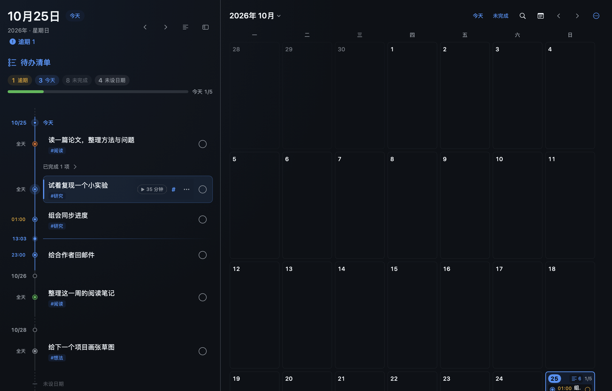
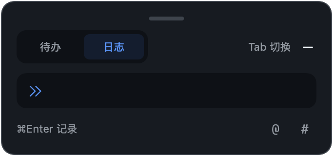
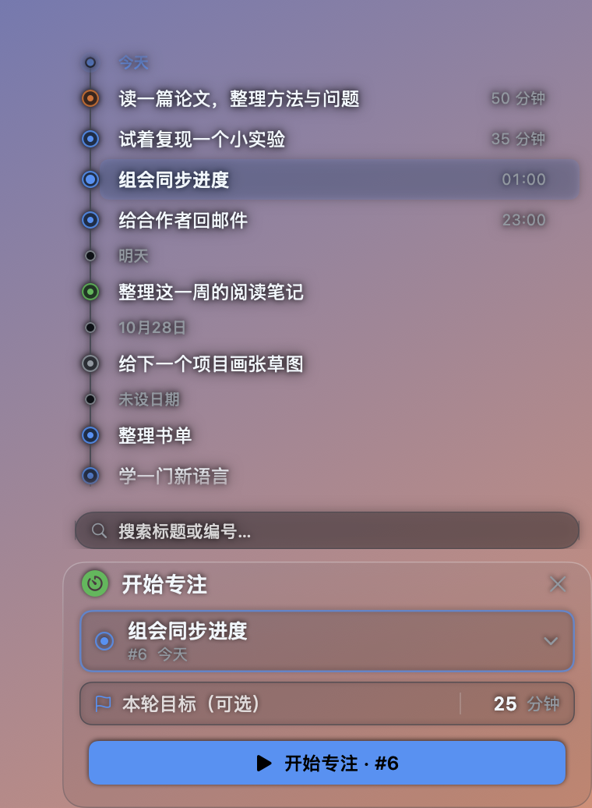
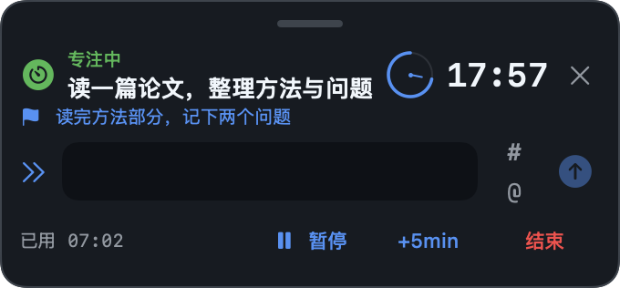
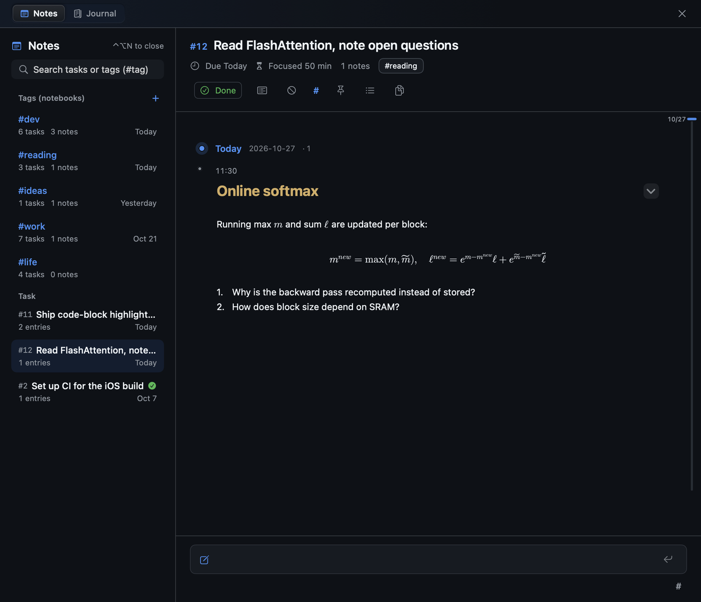
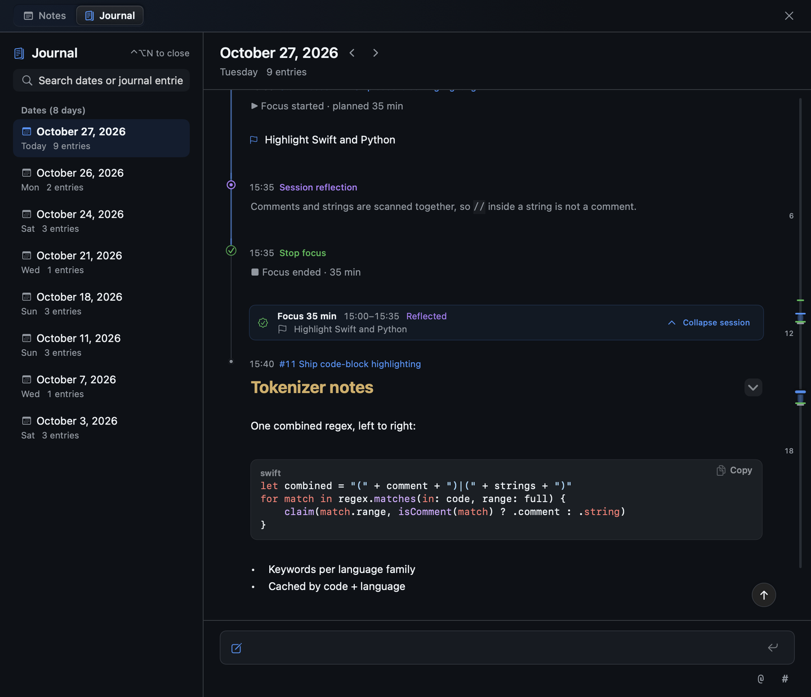

# Timeline

macOS 原生的待办、专注计时、笔记与日记应用，常驻后台，通过全局快捷键或菜单栏图标打开各个面板。无需账号，数据保存在本机。

## 主界面



- 左侧时间轴按日期排列待办，标出今天和当前时刻；右侧月历显示每天的待办数量与专注时长。
- 拖动任务圆点：同一日期内调整顺序，拖入其他日期或日历格修改截止日期。
- 已完成的事项在原位折叠，已放弃的事项收在每个日期的末尾。
- 选中任务后可用单键操作：`空格` 完成，`D` 截止日期，`M` / `⇧M` 推后 / 提前一天，`F` 开始专注，`?` 查看全部快捷键。

## 快速记录



- `⌃⌥L` 在任意应用中打开，添加待办或写一条日志。
- `@` 关联任务，`#` 添加标签，可粘贴图片；图片中的文字会被识别并可搜索。

## 专注计时



- 在面板上方的时间轴中选择任务，设置本轮目标与时长后开始。
- 计时期间面板收起为贴在屏幕边缘的半透明胶囊，显示剩余时间；悬停或点击展开，可暂停、延长、结束或记录笔记。
- 菜单栏同步显示倒计时。结束后在日记中生成本轮小结。



## 笔记



- 每个任务、每个标签各有一本笔记，标签笔记可按待办分章或按日期查看。
- 记录按日期排列在时间线上，支持 Markdown、图片与编辑。

## 日记



- 按天查看全部日志与专注记录，顶部的节奏条显示一天中各条记录的时间分布。
- 每轮专注显示用时、目标与笔记数，可整轮折叠。

## 工作板与终端

- 工作板：每个任务或标签对应一页 Markdown，支持待办勾选、折叠块、代码复制与 Vim 键位。
- 内置终端：支持标签页与分屏。

## 全局快捷键

| 快捷键 | 面板 |
| --- | --- |
| `⌃⌥D` | 主界面 |
| `⌃⌥L` | 快速记录 |
| `⌃⌥F` | 专注计时 |
| `⌃⌥N` | 笔记与日记 |
| `⌃⌥M` | 工作板 |
| `⌃Tab` | 终端 |

快捷键可在设置中修改。

## 安装

需要 macOS 13 及以上和 Swift 工具链。

```sh
bash scripts/install.sh
```

应用安装到 `~/Applications`，数据保存在 `~/Library/Application Support/Timeline`，每天自动备份，可在应用内导出与恢复。

<details>
<summary>开发</summary>

```sh
swift build
swift test --filter TimelineCoreTests
bash scripts/screenshots.sh   # 离屏渲染 README 截图
```

工作板编辑器已离线打包，构建无需 Node.js。修改 `Editor/src` 后，在 `Editor` 目录运行 `npm ci && npm run build`。

</details>
